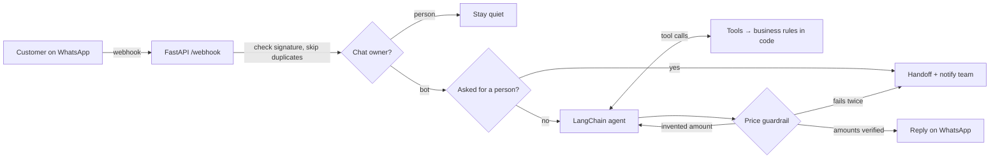

# WhatsApp Agent Starter

**A WhatsApp assistant for businesses, built with LangChain, that won't make up prices.**

Most WhatsApp AI bots are a prompt and a hope. This starter puts the business rules in code: the model talks to the customer, and the code decides prices, availability and when a person has to step in. It ships with a demo business (a car rental company in Buenos Aires) that you can swap for your own.

[](https://github.com/PedroJDre/whatsapp-agent-starter/actions/workflows/ci.yml)


## What it does

- 🔧 **Tools, not guesses.** A LangChain agent searches cars, quotes, creates booking requests and looks up bookings through tools backed by plain Python.
- 💸 **Price guardrail.** Every amount in a reply is checked against what the tools returned. If the model invents a number, the reply is blocked, the model gets one chance to fix it, and if it fails again a person takes over.
- 🙋 **Human handoff.** The bot hands the chat to a person for complaints, accidents, payments or when it isn't sure. If the customer asks for a person, code does it right away, without asking the model. The bot then stays quiet until the team gives the chat back.
- 🔒 **Rules the prompt can't break.** Sunday closures, rental limits, availability, "bookings are requests, not confirmations", and customers can only see their own bookings.
- 📱 **WhatsApp Cloud API.** Signed webhooks are verified, Meta's retries are deduplicated, and non-text messages get a polite reply.
- 📊 **Team dashboard.** Conversations, booking requests, handoffs, blocked replies and tool usage, with a button to give a chat back to the bot.
- 🔁 **Any model.** It defaults to Claude. Change one setting to use any provider LangChain supports.
- ✅ **Tested without an API key.** 27 tests run against a scripted fake model, so CI is free and deterministic.

## How it works



## Quick start: chat in your terminal

You only need Python 3.12+, [uv](https://docs.astral.sh/uv/) and an [Anthropic API key](https://console.anthropic.com/).

```bash
git clone https://github.com/PedroJDre/whatsapp-agent-starter.git
cd whatsapp-agent-starter
cp .env.example .env          # then paste your ANTHROPIC_API_KEY
uv sync
uv run python -m app.cli
```

Things to try: *"Necesito un auto automático del viernes al lunes"*, then *"¿cuánto sale con silla para bebé?"*, then *"dale, a nombre de Ana Pérez"*. Or *"choqué el auto"* to see the handoff.

## Connect it to WhatsApp

1. Create an app at [developers.facebook.com](https://developers.facebook.com/) and add the **WhatsApp** product. Meta gives you a test number.
2. Copy the **access token** and **phone number ID** into `.env`, plus the **app secret** from *App settings → Basic*.
3. Run the server: `uv run uvicorn app.main:create_app --factory --port 8000`.
4. Expose it with a tunnel (for example `ngrok http 8000`) or deploy it (see below).
5. In *WhatsApp → Configuration → Webhook*, set the callback URL to `https://<your-host>/webhook`, enter your `WHATSAPP_VERIFY_TOKEN` as the verify token, and subscribe to **messages**.
6. Send a message to the test number. The dashboard is at `/dashboard?token=<ADMIN_TOKEN>`.

> The test token expires after 24 hours. For production, create a System User token in Business Settings. WhatsApp only allows free-form messages within 24 hours of the customer's last message, so the handoff alert to `HUMAN_NOTIFY_NUMBER` only arrives if that number wrote to the bot recently. Otherwise, use a message template.

## Deploy

- **Docker:** `docker build -t wa-agent . && docker run -p 8000:8000 --env-file .env -v wa-data:/data wa-agent`
- **Render:** `render.yaml` is included. Create a Blueprint from this repo and fill in the secrets. The SQLite database lives on a persistent disk at `/data`.

The server needs to stay running and keep its disk (SQLite), so use a container host like Render, Railway or Fly.io, not a serverless platform.

## Make it yours

| Change | Where |
| --- | --- |
| Products, prices, hours, branches, rules | [`data/business.json`](data/business.json) |
| Pricing, availability and booking logic | [`app/business.py`](app/business.py) |
| What the agent can do | [`app/tools.py`](app/tools.py) |
| Personality and instructions | `SYSTEM_PROMPT` in [`app/agent.py`](app/agent.py) |
| Fixed replies (handoff, fallback) | `TEXTS` in [`app/agent.py`](app/agent.py) |
| When to hand off right away | `HUMAN_REQUEST` in [`app/guardrails.py`](app/guardrails.py) |
| Model / provider | `MODEL` in `.env`, e.g. `openai:<model>` after `uv add langchain-openai` |

The demo is a car rental company, but the same shape fits a clinic (appointments), a store (orders and stock) or a dealership (test drives): swap the data, rewrite the four booking tools, and keep the guardrails.

## Project structure

```
app/
  agent.py       # Bot.handle(): history → agent → guardrails → handoff
  tools.py       # LangChain tools (ToolRuntime context: phone, today, business, db)
  business.py    # Business rules in plain code: quotes, availability, bookings
  guardrails.py  # Price check and "talk to a person" detection
  whatsapp.py    # Signature check, payload parsing, Cloud API client
  main.py        # FastAPI: /webhook, /dashboard, /admin/release, /health
  db.py          # SQLite: conversations, messages, bookings, events
  cli.py         # Terminal chat
data/business.json
tests/           # 27 tests with a scripted fake model, no API key needed
```

## Tests

```bash
uv run pytest
```

## About

Built by [Pedro Dreyer](https://www.linkedin.com/in/pedro-dreyer/) at [Loopers](https://loopersarg.com), where we build AI agents and automations for growing businesses. This is a cleaned-up, open version of the patterns we use in client bots. Need one for your business? [Get in touch](https://loopersarg.com).

MIT licensed.
